 

&nbsp;
&nbsp;
&nbsp;

<table width="100%">
<tr>
<td width="58%" valign="top">

Backend developer from Nepal, currently pursuing my BCA. I build APIs that are **clean, secure and maintainable**, and I care about getting the architecture right before anything else touches it.

My tool of choice is **Django + DRF**. I enjoy the harder parts of backend work: authentication flows, permission systems and data modelling, the foundations everything else sits on.

Right now I'm deepening my **system design**, **PostgreSQL** and **Docker**, and looking for a **backend internship** where I can contribute to real production systems.

> *"First solve the problem. Then write the code."*

</td>
<td width="42%" valign="top" align="center">

**Backend** 

**Focus** 

**Based in** 

</td>
</tr>
</table>

<table width="100%">
<tr>
<td width="50%"></td>
<td width="50%"></td>
</tr>
<tr>
<td width="50%"></td>
<td width="50%"></td>
</tr>
<tr>
<td width="50%"></td>
<td width="50%"></td>
</tr>
</table>

  

  

 

  

  

&nbsp;
&nbsp;

